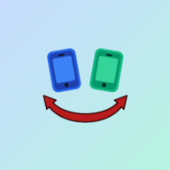
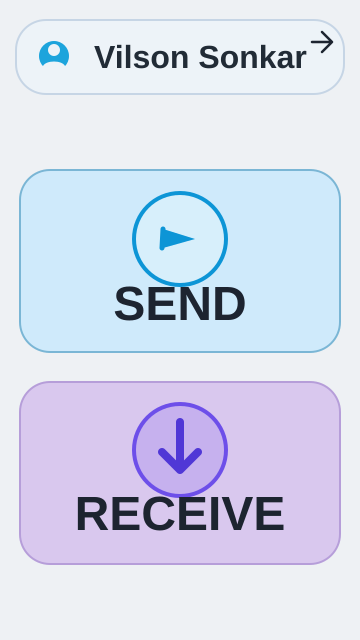
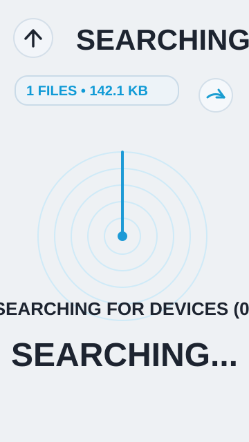
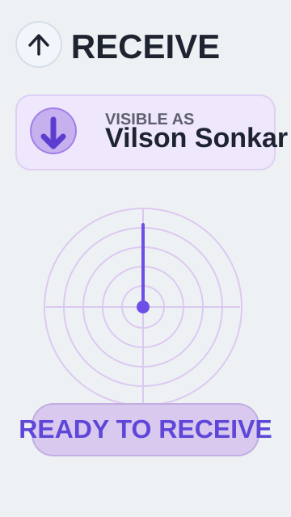

<div align="center">
  
</div>

<h1 align="center">Mini Share</h1>

<p align="center">
  <strong>Developer:</strong> Vilson Sonkar<br />
  <strong>Version:</strong> 1.0 (Build 1)<br />
  <strong>Platform:</strong> Android<br />
  <strong>Language:</strong> Kotlin
</p>

<p align="center">Ultra-light, offline peer-to-peer file sharing over Wi-Fi Direct and Bluetooth discovery.</p>

## App Details

### Send
Choose files on your device, discover nearby peers, and send selected files directly to a connected device.

### Receive
Make your device visible to nearby Mini Share peers and prepare to receive incoming files. Received files are saved to the **Downloads/Mini Share** folder when supported by the device.

### Transfer
Track transfer progress, speed, and status as files move. Transfers use a direct socket connection between Wi-Fi Direct peers and support cancellation.

### Wi-Fi Direct
Discover nearby devices and connect without a router or internet connection to create a local peer-to-peer link for sharing.

### P2P Sharing
Exchange files directly between connected devices instead of uploading them to a cloud service. Bluetooth discovery helpers are included in the app.

## Screenshots

<p align="center">
  
  
  
</p>

## Technology

- **Primary language:** Kotlin
- **UI:** Jetpack Compose and Material 3
- **Platform:** Android
- **Connectivity:** Android Wi-Fi Direct APIs and Bluetooth discovery helpers
- **Minimum Android version:** Android 9 (API 28)
- **Target Android version:** Android 13+ build target (API 36)
- **Package:** `com.aistudio.wifi.share.p2pdrop`
- **App icon:** Android launcher icon from `mipmap-xxxhdpi/ic_launcher.png`

## Getting Started

1. Clone this repository and open it in Android Studio.
2. Allow Gradle to sync the project.
3. Connect an Android device that supports Wi-Fi Direct.
4. Build and run the `app` configuration.
5. Grant the requested nearby-device and file-access permissions when prompted. Enable Wi-Fi and use the app's **Send** or **Receive** flow to find a peer.

## Project Structure

```text
app/src/main/java/com/example/
├── model/       # Transfer data models
├── p2p/         # Wi-Fi Direct management and Bluetooth discovery
├── transfer/    # File transfer engine
├── ui/          # Compose screens and components
└── viewmodel/   # App state and UI coordination
```

## Build Configuration

The Android app uses a minimum SDK of 28, a target SDK of 36, version code `1`, and version name `1.0`. See `app/build.gradle.kts` for the complete Android build and dependency configuration.

## License

This project is licensed under the **GNU General Public License v3.0**. See [LICENSE](LICENSE) for details.
